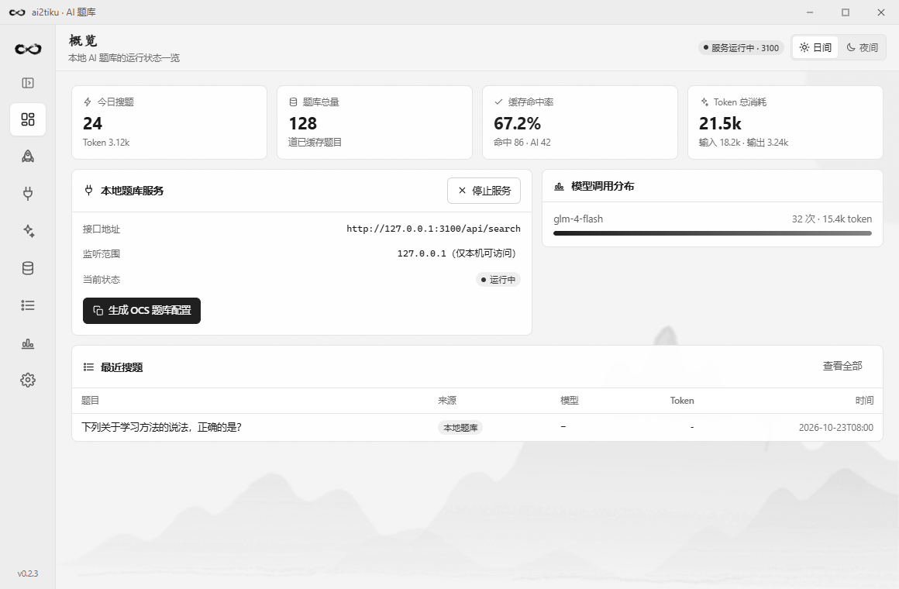
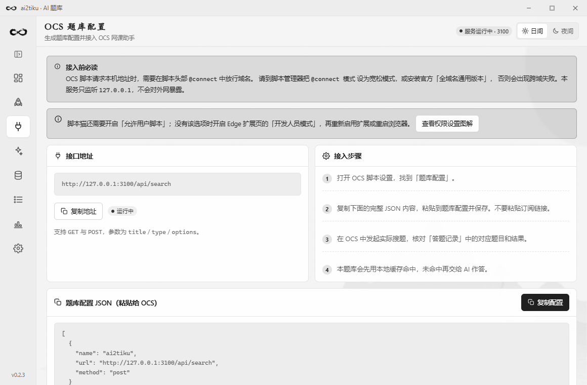
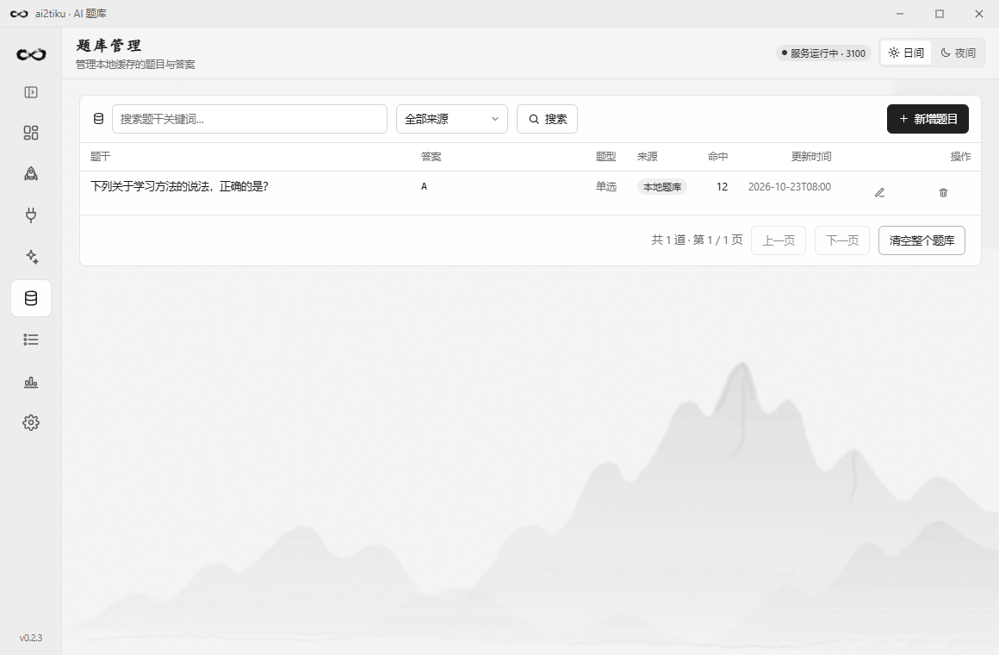
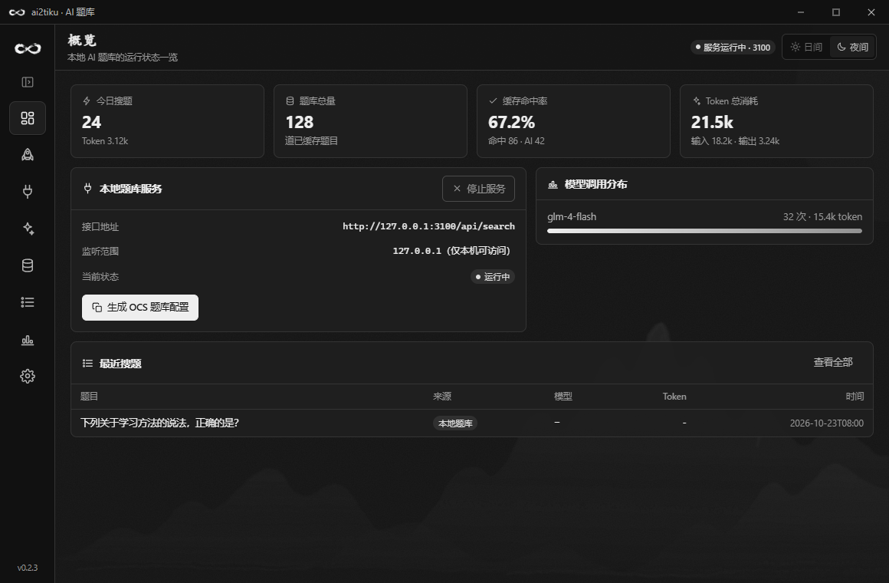

# ai2tiku

把大模型接入 **OCS 网课助手** 的本地 AI 题库。

ai2tiku 是一个基于 **Vue + Tauri / WebView2** 的桌面应用，使用 Rust 提供本地服务与 SQLite 题库。它在你本机跑起一个题库接口，
OCS 脚本通过标准的「题库配置」调用它。**先用本地题库匹配，未命中再交给 AI 作答**，
开启自动缓存后，通过格式校验的纯文本题答案会写入题库；题干精确匹配、题型与完整选项一致时，
可复用本地答案、不再消耗 Token。图片题不使用文本缓存。

> 设计目标与 [Miaozeqiu/ZError](https://github.com/Miaozeqiu/ZError) 类似：
> 为 OCS 搭建本地 AI 题库，支持自定义 AI 供应商与模型。

## 更新记录

2026-10-23（v0.2.3，WebView 主版本）：默认使用 Vue + Tauri 界面，关闭浏览器右键菜单，并将 0.2.1 的折叠侧栏、连续火箭尾焰和控件反馈同步到 WebView。菜单默认仅显示图标，点击顶部按钮平滑展开、收起，文字渐显且图标保持原位；常规按钮和单行字段统一 34px 高度，支持键盘聚焦和减少动态效果。保留黑白水墨视觉、毛笔无限标志和已有业务修复，继续读取原数据库。
详细变化、升级说明与验证结果见 [更新日志](CHANGELOG.md)。

## 功能

- **内置常用供应商预设** —— 智谱 / DeepSeek / 通义千问 / Kimi / 混元 / 火山方舟 / 星火 / 千帆 / MiniMax / OpenAI / Ollama，选中后**只需填 API Key**
- **保存供应商自动获取可用模型** —— 自动请求 `/models` 拉取该厂商的模型并填入，无需手抄模型名
- **OCS 题库配置一键生成** —— 复制完整 JSON，粘贴到 OCS 的题库配置中
- **部署引导** —— 安装步骤统一使用 Edge，包含脚本猫「允许用户脚本」和旧版开发人员模式指引
- **支持 OCS 5.0 图片题优化** —— 题库配置声明了 `${images}` 等参数，题干/选项里的图片
  会以 base64 传给模型（图片题需改用支持视觉的模型，如 glm-4.5v、qwen-vl-max）
- **AI 供应商与模型自定义** —— 任何 OpenAI 兼容服务，可增删模型、设默认、测连通性
- **本地题库管理与缓存** —— 精确核对题干、题型和完整选项，支持增删改查和乱序选项映射
- **答案格式校验** —— 按题型检查答案格式、选项范围和回复完整性，失败结果不作为有效答案缓存
- **答题记录** —— 查看已记录请求的来源、模型、耗时与 Token；部分失败路径尚未留痕
- **统计看板** —— 缓存命中率、Token 消耗趋势、按模型用量分布
- **水墨视觉** —— 毛笔无限标志统一桌面图标与应用 Logo；黑白日夜配色，淡墨山形与纸张纤维背景
- **侧栏交互** —— 默认图标栏，点击展开文字菜单；独立动效与连续喷流的竖直火箭，支持键盘聚焦和减少动态效果
- **控件反馈** —— 黑白悬停、按下与焦点状态，可点击控件显示手型；统一按钮和单行表单尺寸
- **默认强制直连** —— 不受本机代理软件的系统代理影响；需要访问 OpenAI 等被墙服务时可在「设置」里单独填代理

## 截图

WebView 主版本的黑白水墨主题（演示数据）：

| 概览 | OCS 题库配置 |
| --- | --- |
|  |  |

| 本地题库 | 夜间概览 |
| --- | --- |
|  |  |

侧栏默认显示图标，点击顶部展开按钮可查看文字菜单：[展开效果](docs/screenshots/questions-expanded.png)。验证范围见 [WebView 验证记录](docs/webview-validation-0.2.3.md)。

## 技术栈

| 层 | 选型 |
| --- | --- |
| 桌面界面 | Vue 3 + TypeScript + Tauri 2，Windows WebView2 |
| 本地服务 | Rust + axum + Tokio |
| 存储 | rusqlite / SQLite，复用原应用数据库 |
| 视觉 | CSS 图标与粒子动效、黑白日夜主题和水墨背景；毛笔 Logo 使用 PNG |
| 历史实现 | Rust 原生界面源码保留为可选 `native` feature，默认不编译 |

## 下载

去 [v0.2.3 Release](https://github.com/qiuzhenxuan/ai2tiku/releases/tag/v0.2.3) 下载 Windows x64 主版本：

| 文件 | 界面与运行要求 |
| --- | --- |
| [ai2tiku-webview-windows-x64.exe](https://github.com/qiuzhenxuan/ai2tiku/releases/download/v0.2.3/ai2tiku-webview-windows-x64.exe) | Vue + Tauri 界面，包含本轮交互修复，需要 WebView2 Runtime |

升级前先退出正在运行的旧版。Release 同时提供 EXE 的 `.sha256` 和汇总 `SHA256SUMS.txt`。历史 v0.2.1 双版本仍在旧 Release 中保留。

- 主版本面向 Windows 10/11，需要 WebView2 Runtime
- exe 未做代码签名，首次运行 Windows 可能提示"未知发布者"，点"仍要运行"即可
- 每次运行会自动在 `%APPDATA%\com.ai2tiku.app` 下建库，你的 API Key 只存在本机

## 运行

前置要求：Node、pnpm、Rust stable、MSVC 生成工具及 WebView2 Runtime。

```bash
pnpm install
pnpm build
cargo run --manifest-path src-tauri/Cargo.toml --features custom-protocol
cargo test --manifest-path src-tauri/Cargo.toml --locked --lib
cargo build --manifest-path src-tauri/Cargo.toml --release --locked --features custom-protocol
```

Windows 单文件程序位于 `src-tauri/target/release/ai2tiku.exe`。

Rust 原生试验界面源码仍保留，如需对照可显式启用：

```bash
cargo run --manifest-path src-tauri/Cargo.toml --no-default-features --features native
```

## 接入 OCS

1. 在「部署向导」中使用 Edge 安装脚本猫。打开 `edge://extensions/`，进入脚本猫详情，
   开启「允许用户脚本」；旧版或没有这个选项时开启「开发人员模式」。重新启用扩展或重启浏览器后再刷新网课页面。
   操作图解见 [脚本猫官方说明](https://docs.scriptcat.org/docs/use/open-dev/?browser=edge)。
2. 安装 OCS 脚本，在「供应商与模型」中填写 Key，保存并启用供应商和需要的对话模型。
   自动获取模型列表后，请通过本地自测确认所选模型与调用权限可用。
3. 启动本地服务，在「部署向导」或「OCS 接入」页复制**完整 JSON 内容**，粘贴到 OCS 的题库配置并保存。
   最新版 OCS 已不支持将远程链接作为题库配置。更改端口后需要重新复制 JSON；切换模型不需要。
4. 在 OCS 中发起一次实际搜题，在「答题记录」中核对对应题目与返回结果。
   出现 OCS 悬浮面板只代表脚本加载，本地自测成功也不能代替浏览器接入验证。

生成的配置形如：

```json
[
  {
    "name": "ai2tiku (本地 AI 题库)",
    "homepage": "http://127.0.0.1:3100",
    "url": "http://127.0.0.1:3100/api/search",
    "method": "post",
    "contentType": "json",
    "responseType": "json",
    "type": "GM_xmlhttpRequest",
    "headers": { "Content-Type": "application/json" },
    "data": {
      "title": "${title}",
      "type": "${type}",
      "options": "${options}",
      "images": { "handler": "return (env) => env.images" },
      "suggestion_title": "${suggestion_title}",
      "suggestion_options": "${suggestion_options}"
    },
    "handler": "return (res)=> res.code === 1 ? [res.question, res.answer] : [res.msg, undefined]"
  }
]
```

> `contentType` 是 OCS 5.0 之前的旧字段（此后由 `responseType` 取代），两个都写以兼容新旧版本。
> `data` 里对 `${images}` / `${suggestion_title}` / `${suggestion_options}` 的引用是 OCS
> 判定「题库支持图片题优化」的依据（`isAnswererWrapperSupportImageOptimize`），
> 且该判定只认 `method: "post"`。其中 `images` 是 base64 数组，用字段解析器 `{ handler }`
> 返回可保留数组结构（字符串占位符会被拼成一整条字符串）。

> **注意**：OCS 请求本机地址需要在脚本头部 `@connect` 中放行域名。
> 请把脚本管理器的 `@connect 模式` 设为宽松模式，或使用官方「全域名通用版本」脚本。

## 本地接口

服务只监听 `127.0.0.1`，默认端口 `3100`（可在「设置」中修改）。

```
GET  /api/search?title=...&type=...&options=...
POST /api/search   {"title":"...","type":"single","options":"A. xx\nB. yy"}
                   # 图片题另带 images（base64 数组）/ suggestion_title / suggestion_options
GET  /api/status
GET  /ocs          # 导出题库配置 JSON 内容；新版 OCS 不能直接填此链接
```

命中返回：

```json
{
  "code": 1,
  "question": "1 + 1 = ?",
  "answer": "B",
  "source": "cache",
  "similarity": 1.0,
  "model": "本地题库",
  "tokens": 0,
  "durationMs": 1
}
```

未命中返回 `{"code": 0, "msg": "..."}`，OCS 会把它显示为提醒信息。

多选题的答案按 OCS 官方文档的要求，用**特殊符号 `#` 连接**返回（如 `A#C`）；
填空题有多个空时同样用 `#` 连接（如 `张三#李四`）。OCS 的 `splitAnswer`
分隔符列表是 `=== # --- ### | ; ；`，所以这不依赖任何额外解析约定。

## 目录结构

```
├── src/                     # 可选的旧 Vue 界面与共享品牌图像
│   ├── api/                 # Tauri 命令封装与类型
│   ├── components/          # 通用组件
│   ├── composables/         # 主题、提示
│   ├── views/               # 页面
│   └── styles/main.css      # 设计系统（含日夜双主题变量）
└── src-tauri/               # Rust 原生应用与共享业务层（保留原目录名）
    └── src/
        ├── native/          # 原生窗口、页面、布局、表单、动效与视觉验证
        ├── services.rs      # 与界面无关的业务操作
        ├── ai.rs            # OpenAI 兼容调用（作答 / 拉取模型 / 测连通性）
        ├── answers.rs       # 按题型解析与校验答案，拒绝无效或截断回复
        ├── db.rs            # SQLite 存储与题库匹配
        ├── presets.rs       # 内置的常用供应商预设
        ├── ocs.rs           # OCS 题库 JSON 配置的唯一来源
        ├── browser.rs       # Edge 定向打开部署链接与浏览器检测
        ├── server.rs        # 本地 HTTP 服务（含 /ocs JSON 导出端点）
        ├── search.rs        # 缓存优先 + AI 兜底的核心流程
        └── commands.rs      # 可选 WebView 兼容入口的命令
```

## 许可

MIT
